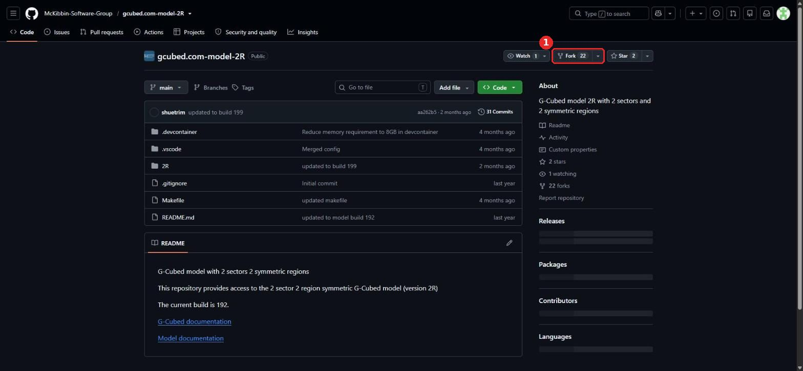
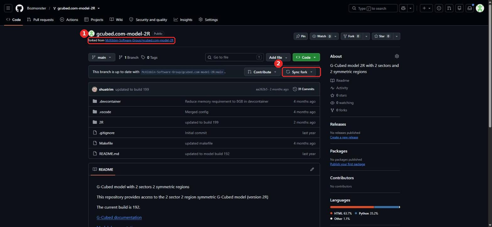

# 1. G-Cubed model repository (public fork)

The pipeline builds the model from **your fork** of McKibbin Software Group's public G-Cubed 2R model. A fork lets you change the model (data, simulations, builds) without touching upstream, and pull upstream updates when they're published.

| Setting | Value |
|---|---|
| Upstream | `McKibbin-Software-Group/gcubed.com-model-2R` |
| Fork | `<you>/gcubed.com-model-2R` |
| Visibility | **Public**. The pipeline clones it without credentials. |
| What the pipeline uses | `2R/199/` (model configuration, data CSVs, SYM-generated Python, templates) |

## Scripted

```bash
bash scripts/setup/1-fork-model-repo.sh
```

The script forks the repo (or syncs an existing fork), checks it is public, and saves its URL. Step 2 then sets that URL as the `MODEL_REPO` variable for the pipeline.

## Manual

**1. Open the upstream repo and click Fork.**
<https://github.com/McKibbin-Software-Group/gcubed.com-model-2R>



**2. Create the fork.** Keep the name and tick **Copy the main branch only**, then click **Create fork**. Forks of public repos are always public.

**3. Check the fork.** It shows **forked from McKibbin-Software-Group/gcubed.com-model-2R** (①). Use **Sync fork** (②) whenever upstream publishes a new build.



**4. Tell the pipeline about it.** If your fork isn't `Bozmonster/gcubed.com-model-2R`, add a repository variable `MODEL_REPO` = `https://github.com/<you>/gcubed.com-model-2R.git` to the pipeline repo (see step 4).

## Changing the model

- **New build (e.g. `2R/200`):** commit it to the fork, then set `GCUBED_MODEL_BUILD` in the Dockerfile (or as a build arg) and run the workflow.
- **Branch or tag:** to deploy one, run the workflow manually and set **model_ref**.
- **gcubed package version:** each build's `README.md` names the version it needs (`gcubed-5.0.1.4` for build 199). Set the workflow's **gcubed_tag** to match, and the Python base image if the wheel requires a different CPython.
