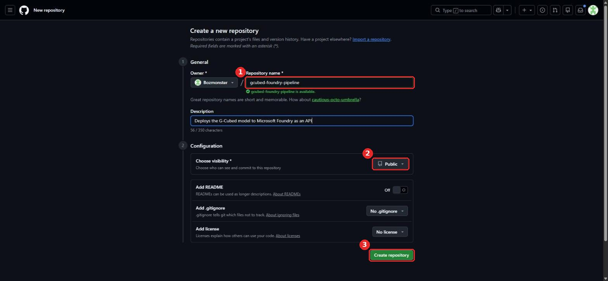
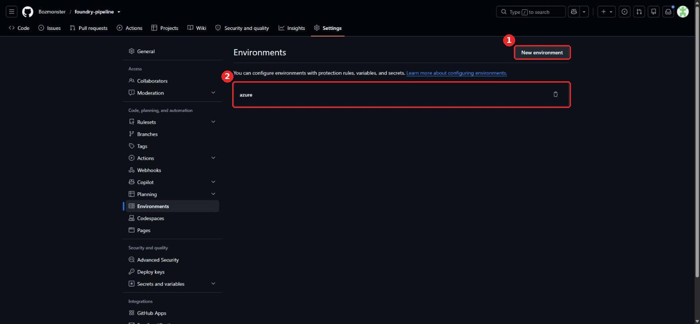

# 2. Pipeline repository

This repository holds everything except the model itself:

| Path | Purpose |
|---|---|
| `app/` | The API: `main.py` (Foundry Invocations server), `gcubed_service.py` (runs G-Cubed), `prepare.py` (solves the model at build time) |
| `Dockerfile` | `python:3.14.5-slim` + gcubed wheel + model + API |
| `infra/main.bicep` | ACR, Foundry resource and project, AcrPull role assignments |
| `.github/workflows/deploy-gcubed.yml` | Build → test → provision → push → deploy → smoke test |
| `scripts/` | Setup, deploy and invoke scripts |
| `examples/` | Example API payloads |

## Scripted

```bash
bash scripts/setup/2-create-pipeline-repo.sh
```

The script:
- creates `<you>/foundry-pipeline` (public or private, your choice) and pushes the code
- creates the GitHub **environment** `azure`, which the workflow deploys through and the Azure OIDC trust is tied to
- sets `MODEL_REPO` if you forked the model in step 1

The first push runs the workflow in **build-and-test-only** mode. The deploy steps skip themselves until step 3 sets the Azure variables.

## Manual

**1. Create an empty repository** at <https://github.com/new>. Enter a name (①) and choose the visibility (②), but don't add a README, .gitignore or license, so the first push is clean. Then click **Create repository** (③).



**2. Push the code** from a clone of this repo:

```bash
git clone https://github.com/Bozmonster/foundry-pipeline my-pipeline && cd my-pipeline
git remote set-url origin https://github.com/<you>/<repo>.git
git push -u origin main
```

**3. Create the `azure` environment.** Go to **Settings → Environments → New environment** (①) and name it `azure` (②). You can add protection rules here, such as required reviewers before each deployment.



**4. Note the repository's numeric IDs**, which step 3 needs:

```bash
curl -s https://api.github.com/repos/<you>/<repo> | python3 -c "import json,sys;d=json.load(sys.stdin);print(d['owner']['login'],d['owner']['id'],d['name'],d['id'])"
```
