# 3. Azure

Everything lives in one resource group, so tearing it down is a single delete.

| Resource | Name (default) | Purpose | Cost |
|---|---|---|---|
| Resource group | `rg-gcubed-foundry` (Australia East) | Container for everything | free |
| User-assigned managed identity | `id-github-foundry-pipeline` | The identity GitHub Actions signs in as (OIDC, no secrets) | free |
| Federated credentials (×4) | on the identity | Trust GitHub tokens from your pipeline repo only | free |
| Role assignments | on the resource group | Let the pipeline create resources and deploy agents | free |
| Container registry | `gcubedacr<unique>` (Basic) | Stores the G-Cubed API image | ≈ US$5/month |
| Foundry resource | `gcubed-foundry-<unique>` (kind AIServices) | Microsoft Foundry account; no model deployments | free at rest |
| Foundry project | `gcubed-project` | Hosts the `gcubed-model` hosted agent | pay per active session |
| AcrPull role ×2 | on the registry | Lets Foundry pull the image | free |

## Scripted (recommended)

In **Azure Cloud Shell (Bash)**, from a clone of the pipeline repo:

```bash
bash scripts/setup/3-azure.sh
```

The script:
1. lets you pick the subscription, region, names and pipeline repo, shows a summary, and asks before it changes anything
2. registers the resource providers (`Microsoft.CognitiveServices`, `Microsoft.ContainerRegistry`, `Microsoft.ManagedIdentity`)
3. creates the resource group and the managed identity
4. adds federated credentials for both GitHub subject formats (classic `repo:owner/repo:…` and ID-based `repo:owner@id/repo@id:…`), each for the `azure` environment and the `main` branch
5. grants the identity four roles on the resource group (retrying while the new identity replicates)
6. deploys `infra/main.bicep`: ACR, Foundry resource and project, and AcrPull for Foundry's identities
7. gives you **Azure AI User** so you can call the API
8. sets the five GitHub repository variables, if `gh` is logged in; otherwise it prints them

It is safe to re-run: every step is idempotent. Here is a real run against the existing deployment: the summary of what it will create (①), then each resource confirmed (②):

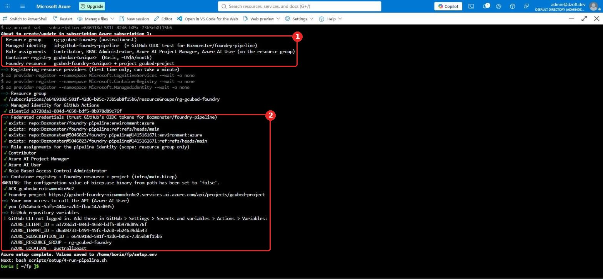

> **Why Cloud Shell?** New tenants have *security defaults* (MFA) enabled. Tokens from a local `az login` lack the MFA claim, so Entra and Graph calls fail with `AADSTS530035`. Cloud Shell inherits your browser's MFA sign-in.

## Manual (Azure portal)

### 3.1 Resource group

**Create a resource** → **Resource group**. Enter the name (①) and region (②), then **Review + create** (③).

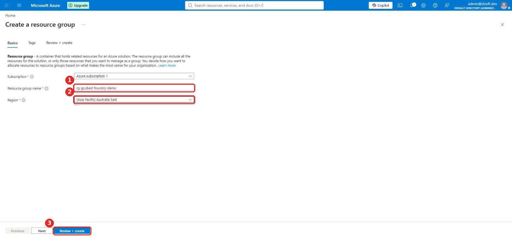

### 3.2 Managed identity for GitHub Actions

**Create a resource** → **User Assigned Managed Identity**. Choose the resource group (①), the name `id-github-foundry-pipeline` (②) and the same region (③). Note its **Client ID** on the Overview page: it becomes `AZURE_CLIENT_ID`.

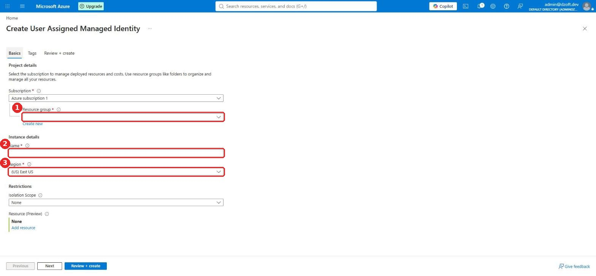

### 3.3 Federated credentials (OIDC trust)

Open the identity → **Settings → Federated credentials** → **Add Credential** (①).

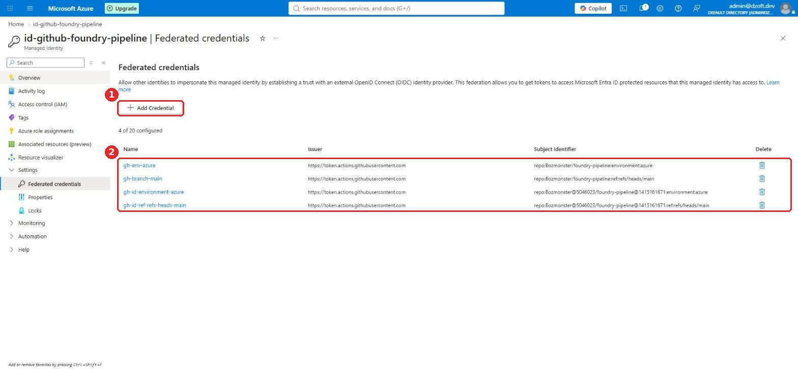

Choose the scenario **GitHub Actions deploying Azure resources** (①) and fill in the fields (②):

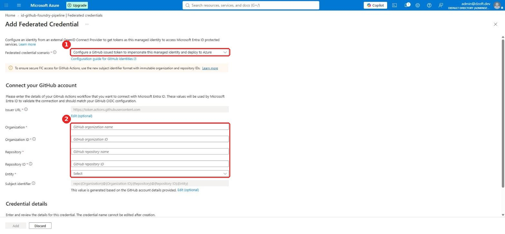

Create **four** credentials, so both subject formats and both entities are trusted:

| Name | Organization | Org ID | Repository | Repo ID | Entity | Subject that results |
|---|---|---|---|---|---|---|
| `gh-id-environment-azure` | Bozmonster | 5046023 | foundry-pipeline | 1415161671 | Environment `azure` | `repo:Bozmonster@5046023/foundry-pipeline@1415161671:environment:azure` |
| `gh-id-ref-refs-heads-main` | 〃 | 〃 | 〃 | 〃 | Branch `main` | `…:ref:refs/heads/main` |
| `gh-env-azure` | use **Edit (optional)** on *Subject identifier* | | | | | `repo:Bozmonster/foundry-pipeline:environment:azure` |
| `gh-branch-main` | 〃 | | | | | `repo:Bozmonster/foundry-pipeline:ref:refs/heads/main` |

Get the IDs with the `curl` command at the end of step 2. If the workflow fails with `AADSTS700213 No matching federated identity record found`, the error message shows the exact subject GitHub sent: add a credential with that subject.

### 3.4 Role assignments

Open the resource group → **Access control (IAM)** → **Role assignments** (①) → **Add role assignment** (②).

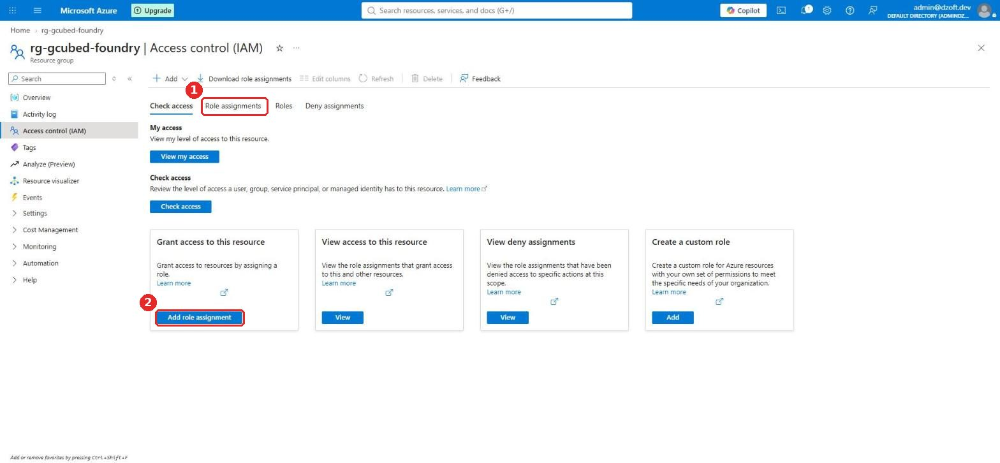

Add these assignments, scoped to the resource group:

| Role (new name / old name) | Assign to | Why |
|---|---|---|
| Contributor | `id-github-foundry-pipeline` | Create ACR and Foundry resources; push images |
| Role Based Access Control Administrator | `id-github-foundry-pipeline` | Bicep grants AcrPull to Foundry |
| Foundry Project Manager / Azure AI Project Manager | `id-github-foundry-pipeline` | Create hosted-agent versions |
| Foundry User / Azure AI User | `id-github-foundry-pipeline` **and you** | Call the agent (smoke test; your own calls) |

The finished list looks like this (①):

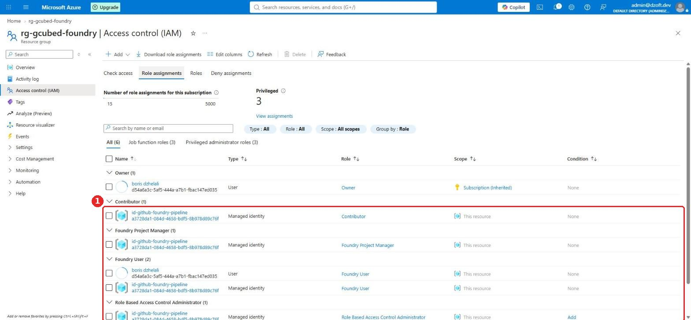

### 3.5 Container registry and Foundry (optional when done manually)

The pipeline's Bicep creates these on its first run, so you can skip this section. To create them by hand:

**Container registry.** **Create a resource → Container Registry**. Enter the name (①) and the region (②); choose the **Basic** pricing plan (③) and **RBAC Registry Permissions** (④).

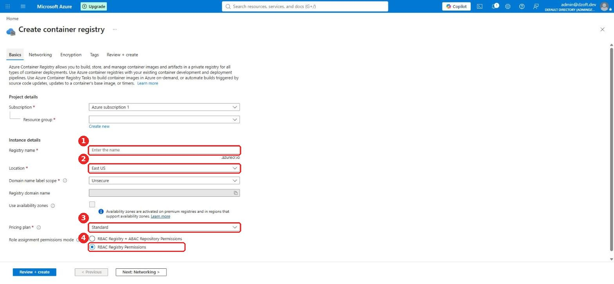

**Foundry resource and project.** **Create a resource → Foundry**. Choose the resource group, name and region (①), and set **Default project name** = `gcubed-project` (②).

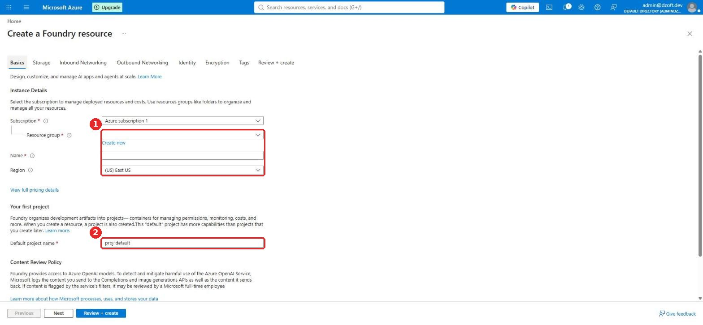

Then, on the **registry → Access control (IAM)**, give **AcrPull** to the **Foundry project's managed identity** and to the **Foundry resource's managed identity**.

After the first pipeline run, the Foundry resource shows its region and kind (①). The registry contains the `gcubed-model-api` repository (①):

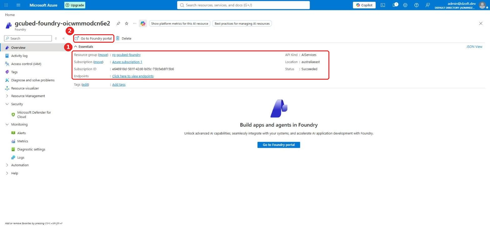
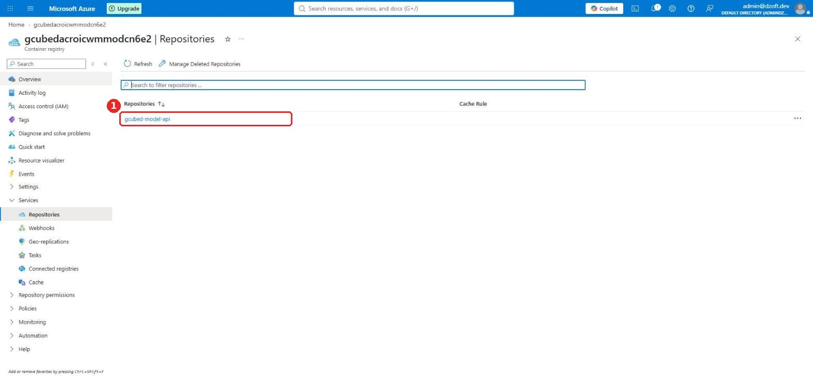
