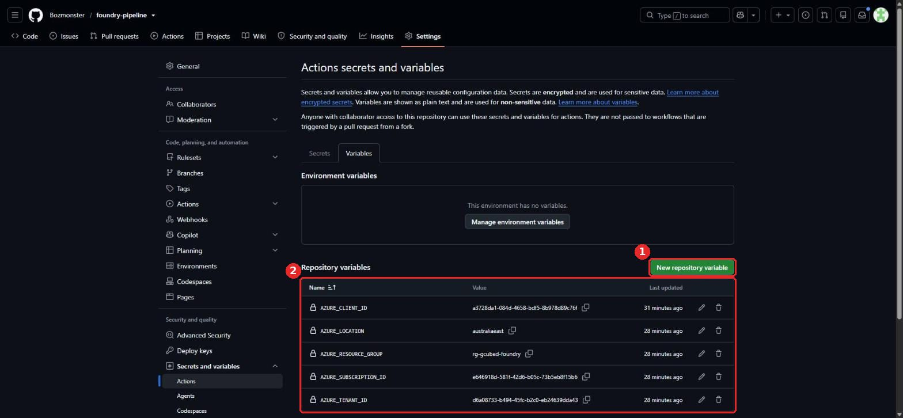
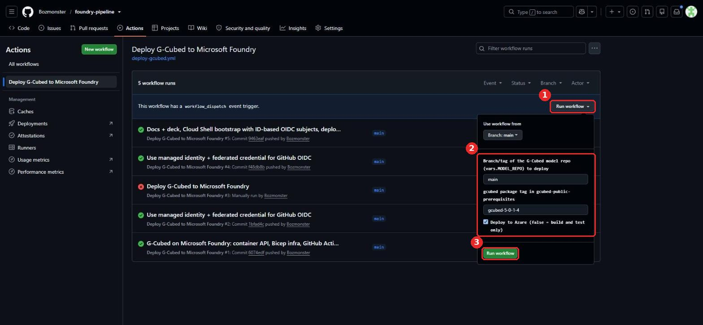
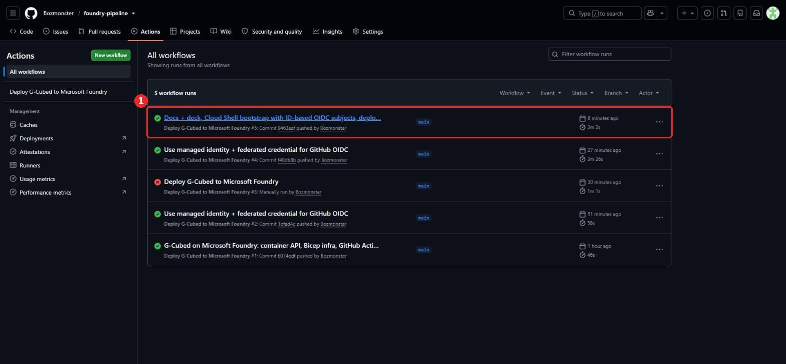
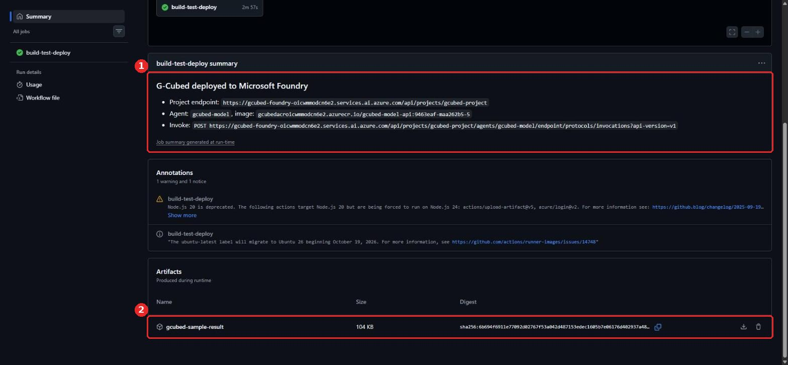

# 4. GitHub Actions pipeline

The workflow is `.github/workflows/deploy-gcubed.yml`. It runs on every push to `main` that touches `app/`, `infra/`, `scripts/`, the Dockerfile or the workflow itself, and on demand.

| # | Step | What happens |
|---|---|---|
| 1 | Fetch | Clones `MODEL_REPO` at `model_ref` and the gcubed wheel at `gcubed_tag` |
| 2 | Build | `docker build`. `prepare.py` solves the model inside the image, so a broken model fails here. |
| 3 | Test | Runs the container on the runner and checks that a +1pp inflation-target shock moves inflation |
| 4 | Login | `azure/login` with OIDC as the managed identity (no secrets) |
| 5 | Provision | `az deployment group create` with `infra/main.bicep` (idempotent) |
| 6 | Push | Tags the image `<commit>-m<model commit>-<run>` and pushes it to ACR |
| 7 | Deploy | `scripts/deploy-agent.sh` creates a new hosted-agent version and waits until it is `active` |
| 8 | Verify | Calls the API through Foundry (`health`, then an experiment) |
| 9 | Report | `scripts/invoke-report.sh` fetches G-Cubed's HTML charts through Foundry and uploads them as an artifact |

Steps 4–9 run only when the Azure variables exist, and are skipped for a manual run with **deploy** unticked.

## Scripted

```bash
bash scripts/setup/4-run-pipeline.sh
```

The script checks the repository variables, starts the workflow, watches it to completion, then calls the deployed API and saves the HTML report to `./gcubed-report/`.

## Manual

### 4.1 Repository variables

Go to **Settings → Secrets and variables → Actions → Variables → New repository variable** (①) and add each row (②).



| Variable | Value | Where it comes from |
|---|---|---|
| `AZURE_CLIENT_ID` | client ID of `id-github-foundry-pipeline` | Identity → Overview |
| `AZURE_TENANT_ID` | your tenant ID | `az account show --query tenantId` |
| `AZURE_SUBSCRIPTION_ID` | subscription ID | `az account show --query id` |
| `AZURE_RESOURCE_GROUP` | `rg-gcubed-foundry` | step 3 |
| `AZURE_LOCATION` | `australiaeast` | step 3 |
| `MODEL_REPO` *(optional)* | `https://github.com/<you>/gcubed.com-model-2R.git` | step 1 |

These are variables, not secrets: none of them grants access on its own. Access comes from the OIDC trust in step 3.

### 4.2 Run the workflow

Go to **Actions → Deploy G-Cubed to Microsoft Foundry → Run workflow** (①). Optionally pick the model branch and gcubed version (②), then click **Run workflow** (③). A push to `main` does the same thing automatically.



### 4.3 Watch it and read the results

Each run appears in the list (①). A full deploy takes about 3 minutes.



The run summary shows the project endpoint, agent, image and invoke URL (①). The **gcubed-sample-result** artifact (②) contains the JSON response and G-Cubed's HTML chart reports, generated by the deployed agent.



### Troubleshooting

| Symptom | Fix |
|---|---|
| `AADSTS700213 No matching federated identity record` | Add a federated credential with the exact subject shown in the error (step 3.3) |
| `AuthorizationFailed` during Bicep | The identity is missing Contributor or RBAC Administrator on the resource group |
| Agent version `failed`, `image_pull_failed` | AcrPull is missing for the Foundry project identity, or the registry isn't reachable |
| `PermissionDenied` when creating the agent | Missing Foundry Project Manager (Azure AI Project Manager) |
| Deploy steps skipped | `AZURE_CLIENT_ID` is not set, or **deploy** was unticked |
