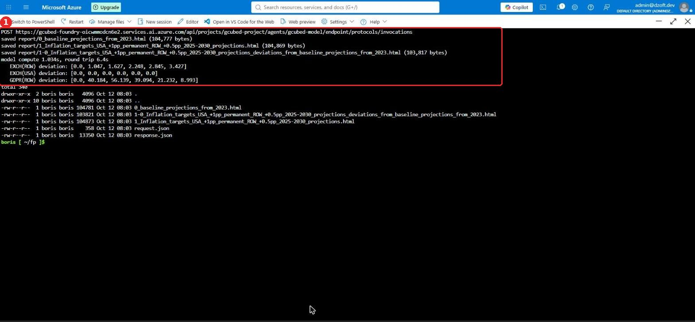
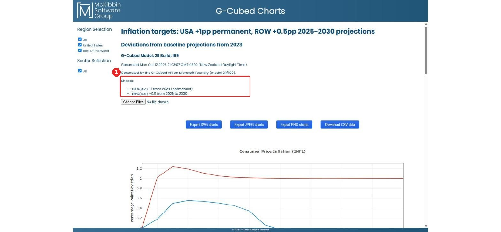
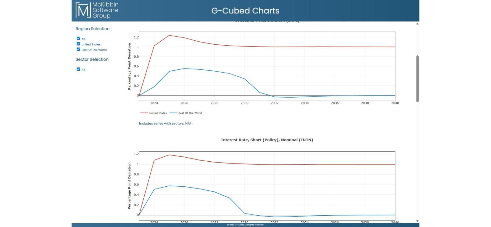

# 5. Using the API

```
POST https://<foundry>.services.ai.azure.com/api/projects/gcubed-project/agents/gcubed-model/endpoint/protocols/invocations?api-version=v1
Authorization: Bearer <Entra token for https://ai.azure.com>
Content-Type: application/json
```

The caller needs **Foundry User / Azure AI User** on the resource group.

## Payload

```json
{
  "action": "run",
  "name": "Inflation targets: USA +1pp permanent, ROW +0.5pp 2025-2030",
  "variables": ["INFL", "INTN", "INTR", "GDPR", "EXCH", "TBAL"],
  "first_year": 2023,
  "last_year": 2040,
  "report": "html",
  "shocks": [
    { "variable": "INFX(USA)", "value": 1,   "start_year": 2024 },
    { "variable": "INFX(ROW)", "value": 0.5, "start_year": 2025, "end_year": 2030 }
  ]
}
```

| Field | Meaning |
|---|---|
| `action` | `run` (default), `describe` (lists variables, units and regions) or `health` |
| `variables` | Full names (`GDPR(USA)`) or prefixes (`GDPR` covers every region) |
| `first_year`, `last_year` | Years returned (model base year 2023, projections to 2100) |
| `shocks` | Each is added to an exogenous variable from `start_year` to `end_year`, or permanently if `end_year` is omitted. G-Cubed validates the variable names. |
| `report` | `"html"` also returns G-Cubed's interactive chart pages in `html_reports` |

The response contains `baseline`, `experiment`, `deviation_from_baseline`, `variables` (description and units), `elapsed_seconds` and, if requested, `html_reports`.

## Send a payload and render the HTML

```bash
export PROJECT_ENDPOINT=https://gcubed-foundry-oicwmmodcn6e2.services.ai.azure.com/api/projects/gcubed-project
bash scripts/invoke-report.sh examples/two-region-inflation-targets.json report
```

Running this in Cloud Shell, Foundry returned three HTML reports. The model compute took about 1 s; the round trip, including Azure CLI token acquisition, took 6.4 s (①):



To view the reports from Cloud Shell, run `(cd report && python3 -m http.server 8000 &)` and then **Web preview → Configure → 8000 → Open and browse**. Locally, just open the `.html` files.

The report generated by the Foundry-hosted model, with the shocks listed from the payload (①):



USA inflation rises about 1.2 pp, then settles at +1 pp (the new target). Rest of World's temporary +0.5 pp target produces a hump that unwinds after 2030. Policy rates follow:



## From code

```python
import requests
from azure.identity import DefaultAzureCredential

token = DefaultAzureCredential().get_token("https://ai.azure.com/.default").token
url = f"{PROJECT_ENDPOINT}/agents/gcubed-model/endpoint/protocols/invocations?api-version=v1"
r = requests.post(url, json={"variables": ["GDPR"], "shocks": [
        {"variable": "INFX(USA)", "value": 1, "start_year": 2024}]},
    headers={"Authorization": f"Bearer {token}"}, timeout=120)
print(r.json()["deviation_from_baseline"])
```

## Give someone else access

```bash
bash scripts/setup/5-grant-api-access.sh        # prompts for an email or object ID
```

Or, in the portal: **Resource group → Access control (IAM) → Add role assignment → Foundry User (Azure AI User) → the person**.

## Tear everything down

```bash
bash scripts/setup/teardown.sh                  # deletes the resource group after you type its name
```

Foundry resources are soft-deleted. Purge them with `az cognitiveservices account purge` if you want to reuse the name immediately.
